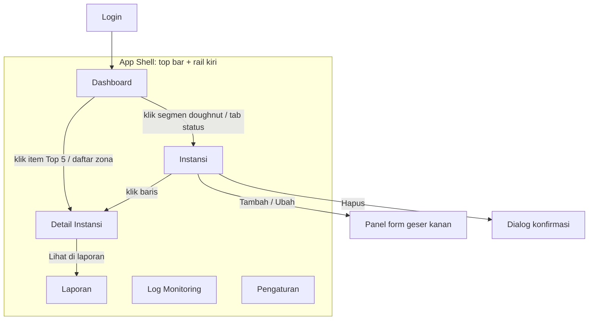

# Desain Frontend & Navigasi — Monitoring Website Dinas

Tanggal: 2026-11-07
Status: Draft, menunggu persetujuan
Cakupan: **frontend dan navigasi saja**. Backend (crawler, cron, kalkulasi status) dibahas terpisah.

---

## 1. Intent

Aplikasi untuk **satu Super Admin (Diskominfo)** memantau website SKPD/instansi pemerintah: apakah server hidup, dan apakah kontennya masih diperbarui. Frontend harus membuat dua hal itu terbaca sekilas di layar laptop/monitor, membawa admin dari "ada yang kuning/merah" ke "instansi mana dan sejak kapan" dalam satu-dua klik, dan menghasilkan laporan yang layak diserahkan ke pimpinan.

Keputusan yang diambil user dalam diskusi:

| Topik | Keputusan |
|---|---|
| Stack | Laravel + Inertia + React (backend Laravel menyusul) |
| Gaya visual | Mengacu referensi Pinterest bergaya glassmorphism visionOS (top bar pill, rail ikon vertikal, bento grid, tab pill di bawah) |
| Tool desain | Google Stitch |
| Tema | Dark mode utama; toggle ke light mode sebagai fitur kecil tambahan |
| Perangkat | Laptop/monitor saja, tidak perlu versi mobile |
| Pendekatan | **B** — Stitch untuk design system + 3 layar inti, layar lain langsung di kode |

## 2. Goals, Non-goals, Anti-goals

**Goals**
- Status tiap instansi (Aktif / Kurang Aktif / Tidak Aktif) terbaca dalam < 5 detik setelah dashboard terbuka.
- Setiap instansi menampilkan freshness konkret: "Terakhir update: 2 hari yang lalu".
- Klik pada grafik/filter status langsung membuka daftar instansi di zona tersebut.
- CRUD instansi cepat tanpa pindah halaman.
- Laporan bisa difilter (instansi, rentang tanggal, status) dan di-export PDF/Excel.

**Non-goals**
- Tampilan mobile/tablet.
- Multi-user, role, registrasi.
- Mesin monitoring nyata (crawler, network check, cron). Fase ini memakai data contoh di database.

**Anti-goals** (gagal walau "jalan")
- Efek kaca membuat teks, angka, atau warna status sulit dibaca.
- Tabel Laporan tidak terbaca saat ditampilkan di proyektor/layar rapat.
- Angka dummy tampil seolah data asli tanpa penanda.
- Tombol/menu yang tidak melakukan apa-apa.

## 3. Constraints

- Lebar layar minimum yang didukung: **1366px**. Target utama 1440–1920px.
- Bahasa antarmuka: **Bahasa Indonesia**.
- Status hanya tiga, dengan arti tetap:
  - **Aktif (hijau)** — HTTP 200 dan ada konten baru ≤ 30 hari.
  - **Kurang Aktif (kuning)** — HTTP 200 tapi konten terakhir > 30 hari.
  - **Tidak Aktif (merah)** — down (500/404/502/timeout) atau domain kedaluwarsa.
- Warna status tidak boleh jadi satu-satunya penanda (selalu disertai label teks/ikon) — aksesibilitas dan cetak hitam-putih di PDF.
- Frontend tidak boleh menghitung status sendiri; status datang dari backend (props Inertia).

## 4. Approaches

| | A. Semua layar di Stitch | **B. Stitch untuk 3 layar inti (dipilih)** |
|---|---|---|
| Isi | ±8 layar didesain di Stitch lalu dikonversi | Dashboard, Instansi, Laporan di Stitch → `DESIGN.md`; layar lain langsung di kode |
| Kelebihan | Semua layar disetujui visual sebelum kode | Lebih cepat; 3 layar sudah memuat hampir semua pola visual |
| Kekurangan | Lambat, HTML Stitch butuh banyak refactor, revisi bolak-balik | Layar sederhana baru terlihat setelah jadi kode |

Dipilih **B** karena layar sisa (Login, Detail, Log, Pengaturan, panel form, dialog) tersusun dari pola yang sudah ada di tiga layar inti.

## 5. Arsitektur Navigasi

### 5.1 Peta layar

### 5.2 Rute

| Rute | Halaman | Catatan |
|---|---|---|
| `/login` | Login | Di luar App Shell |
| `/` | Dashboard | Halaman awal setelah login |
| `/instansi` | Daftar Instansi | Query `?status=aktif\|kurang-aktif\|tidak-aktif&q=` |
| `/instansi/{id}` | Detail Instansi | |
| `/laporan` | Laporan | Query `?instansi=&dari=&sampai=&status=` |
| `/log` | Log Monitoring | Riwayat mentah tiap pengecekan |
| `/pengaturan` | Pengaturan | |

Filter disimpan di query string supaya tombol Back browser dan link yang dibagikan tetap membawa filter yang sama.

### 5.3 App Shell

- **Top bar (pill mengambang):** kiri — sapaan "Selamat datang, Admin Diskominfo"; tengah — pencarian instansi (lompat ke Detail); kanan — info "Cek terakhir: 14:00 · berikutnya 20:00", tombol **Cek Sekarang**, toggle tema, lonceng notifikasi (instansi yang baru berubah ke merah sejak dibuka terakhir), menu akun (Logout).
- **Rail kiri (vertikal, ikon + tooltip):** Dashboard, Instansi, Laporan, Log Monitoring, Pengaturan. Item aktif ditandai lingkaran terang seperti referensi. Logout ada di menu akun, bukan di rail.
- **Area konten:** panel besar di tengah sesuai referensi.
- **Tab pill bawah:** hanya di Dashboard dan Instansi, berisi filter status `Semua · Aktif (n) · Kurang Aktif (n) · Tidak Aktif (n)`. Di Dashboard, memilih tab = pindah ke `/instansi?status=...`.

## 6. Spesifikasi Layar

### 6.1 Login
Satu kartu kaca di tengah di atas latar gradien gelap. Field: username/email, password, tombol Masuk. Error ditampilkan inline ("Kredensial salah"). Tanpa link daftar/lupa password.

### 6.2 Dashboard — *didesain di Stitch*
Tugas layar: **menjawab "website mana yang bermasalah sekarang?"** Bento grid dengan ukuran kartu mengikuti bobot isi:

| Kartu | Ukuran | Isi |
|---|---|---|
| Rasio status | besar | Doughnut 3 segmen + angka total di tengah; judul "Status 42 website per cek terakhir". Klik segmen → `/instansi?status=…` |
| Perlu perhatian | besar | Daftar instansi merah lalu kuning, tiap baris: nama, badge status, "Terakhir update: 4 bulan yang lalu" / "Down sejak 6 jam". Klik → Detail |
| Top 5 tercepat | sedang | Nama + response time (ms) |
| Top 5 paling usang | sedang | Nama + umur konten ("187 hari") |
| Ringkasan jadwal | kecil | Cek terakhir, cek berikutnya, jumlah gagal cek |

Kartu "Perlu perhatian" adalah usulan tambahan: kartu ini yang paling langsung menjawab tugas layar.

### 6.3 Instansi — *didesain di Stitch*
Tabel padat (panel hampir solid). Kolom berurutan dari yang menentukan keputusan: **Status**, **Nama Instansi**, **Freshness** ("2 hari yang lalu"), **Response time**, **HTTP terakhir**, **URL**, **Sumber konten** (Sitemap/RSS/DOM), aksi (Ubah, Hapus). Pencarian + tab status. Tombol **Tambah Instansi**.

**Panel form (geser dari kanan):** Nama Instansi, URL Website Utama, URL Sitemap/RSS (opsional). Validasi format URL inline. Simpan / Batal.
**Dialog hapus:** "Hapus Dinas X? Riwayat monitoringnya ikut terhapus." Tombol Hapus berwarna merah.

### 6.4 Detail Instansi — *langsung di kode*
Header: nama, URL (link keluar), badge status besar, freshness, tombol **Cek Sekarang**, Ubah. Isi: grafik garis response time 30 hari, persentase uptime (7/30 hari), tanggal konten terakhir + sumbernya, tabel riwayat cek (waktu, HTTP, response time, tanggal konten terdeteksi, status hasil).

### 6.5 Laporan — *didesain di Stitch*
Dirancang untuk layar lebar/proyektor: font tabel lebih besar, panel solid, kontras tinggi. Bar filter: instansi (multi-select), rentang tanggal (preset Bulan ini / Kuartal ini / Kustom), status. Ringkasan di atas tabel per instansi: uptime %, jumlah downtime, rata-rata response time, hari sejak update terakhir, status akhir periode. Tombol **Export PDF** dan **Export Excel** mengikuti filter yang aktif.

### 6.6 Log Monitoring — *langsung di kode*
Tabel kronologis seluruh pengecekan (semua instansi), filter instansi + hasil (sukses/gagal), pesan error mentah (mis. "cURL timeout 30s").

### 6.7 Pengaturan — *langsung di kode*
Ganti password; tampilan interval cron (read-only atau editable — diputuskan saat fase backend); ambang hari freshness (default 30); preferensi tema.

## 7. Bahasa Visual

- **Tema dark:** latar gradien gelap samar (navy → hampir hitam) supaya efek kaca punya sesuatu di belakangnya; bukan foto.
- **Kaca hanya di kerangka:** top bar, rail kiri, tab pill bawah, panel form. Kartu dashboard semi-solid; tabel Instansi/Laporan hampir solid demi keterbacaan.
- **Warna status:** hijau / kuning / merah dengan kontras ≥ 3:1 terhadap latar kartu (≥ 4.5:1 untuk teks), selalu disertai label.
- **Aksen:** satu warna aksen untuk aksi utama (Cek Sekarang, Tambah, Export). Ditetapkan di Stitch.
- **Radius:** pill untuk shell (top bar, rail, tab bawah), radius sedang untuk kartu, kecil untuk input/tabel.
- **Light mode:** dibangun lewat design token (CSS variables). Tidak didesain di Stitch; dikerjakan terakhir.
- **Data dummy:** selama fase frontend, tampilkan penanda kecil "Data contoh" di top bar.

## 8. Stack Frontend (keputusan builder)

- Laravel React starter kit (Inertia + React + TypeScript + Tailwind).
- Data contoh dikirim lewat props Inertia dari controller yang membaca database (lihat 10a).
- Recharts (doughnut yang bisa diklik, grafik garis), TanStack Table (tabel Instansi/Laporan/Log).
- Format waktu relatif Bahasa Indonesia ("2 hari yang lalu") lewat util tanggal (mis. date-fns locale `id`).

## 9. State yang Wajib Ada

- **Kosong (pertama kali):** "Belum ada instansi yang dipantau. Tambahkan instansi pertama." + tombol Tambah.
- **Filter tanpa hasil:** "Tidak ada instansi berstatus Kurang Aktif." + tombol reset filter.
- **Belum pernah dicek:** instansi baru tampil dengan status abu-abu "Menunggu cek pertama" (bukan salah satu dari tiga status).
- **Konten tidak terdeteksi:** freshness tampil "Tanggal konten tidak ditemukan" — perlakuan statusnya diputuskan di fase backend.
- **Cek Sekarang berjalan:** tombol berubah jadi "Mengecek…" dan nonaktif.

## 10. Keputusan Tambahan (hasil review builder — keputusan perancang, boleh dikoreksi)

1. **Filter, pencarian, paginasi di server.** Controller membaca query string dan mengirim props yang sudah terfilter (Inertia partial reload). Ini kontrak yang dipertahankan saat backend nyata masuk.
2. **Laporan:** satu baris = satu instansi yang dirangkum selama periode. Filter status = **status di akhir periode**. Rincian per-cek tidak ada di Laporan, cukup di Detail Instansi. Kolom export = kolom tabel.
3. **Status abu-abu ("Menunggu cek pertama")** tidak masuk doughnut dan tidak punya tab sendiri. Instansi abu-abu hanya muncul di tab "Semua". Subjudul doughnut menyebut cakupannya: "40 dari 42 website sudah dicek". `?status=` hanya menerima 3 nilai.
4. **"Tanggal konten tidak ditemukan"** hanya label freshness. Frontend menampilkan status apa pun yang dikirim backend tanpa logika sendiri.
5. **Alur Stitch:** buat project Stitch baru → 3 layar inti + `DESIGN.md` → **berhenti untuk review user** → baru mulai kode. Aksen dan token ditentukan bebas di tahap ini.

## 10a. Data di Fase Frontend (keputusan user)

Menggunakan **database Laravel sungguhan dengan data contoh** (bukan dummy di memori):

- **Migrasi + seeder:** tabel instansi, riwayat cek, dan pengaturan, diisi data contoh realistis untuk ±40 instansi dan riwayat ±90 hari. Nama instansi berupa placeholder yang jelas (mis. "Dinas Contoh 01"), bukan nama SKPD asli.
- **Auth:** login sungguhan dengan satu akun Super Admin dari seeder. Registrasi, reset password, dan verifikasi email bawaan starter kit dihapus. Ganti password di Pengaturan berfungsi.
- **CRUD instansi** benar-benar menyimpan ke database.
- **Pengaturan ambang hari** tersimpan. Status dihitung ulang dari data riwayat contoh.
- **Export PDF/Excel** dibuat di server lewat route yang membaca query filter yang sama dengan halaman Laporan. PDF memakai layout cetak khusus yang tetap terbaca dalam hitam-putih.
- **Cek Sekarang** memanggil service tiruan (`FakeMonitor`) yang membuat entri riwayat acak. Fase backend cukup mengganti service ini dengan yang asli, kontraknya tetap sama.
- **Lonceng notifikasi:** daftar instansi yang statusnya berubah ke merah sejak waktu "terakhir dibuka" milik admin (disimpan di database).
- Penanda "Data contoh" tetap tampil di top bar selama `FakeMonitor` masih dipakai.

## 11. Diserahkan ke Builder

- Ikon, font, dan nilai warna persis (ditetapkan saat membuat design system di Stitch).
- Animasi (minimal: transisi panel form, hover).
- Struktur folder komponen React.
- Detail tooltip dan teks mikro.
